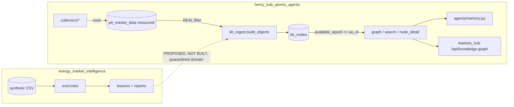

# Fusion Director assessment: graphical KB (`henry_hub_atomic_agents`) x `energy_market_intelligence`

Assessed 2026-11-17. Scope: only `/home/joey/Projects/henry_hub_atomic_agents` (HH) and `/home/joey/Projects/energy_market_intelligence` (EMI).
Every statement below is tagged with how it was established. **E** = executed and observed, **S** = read in source, **U** = not verified.

## 1. Verdict on the central question

> Can the graphical persistent vector knowledge library and the EMI content-generation system become a mutually enriching knowledge infrastructure that produces substantially better intelligence than either produces alone?

**Not as the two repositories stand today. Direct fusion is not recommended, and shared storage or a shared retrieval index would actively harm HH.**
A narrow, one-way, strictly quarantined path (EMI concept notes -> HH under a new, default-excluded provenance) is feasible but has **no measured benefit and no way to measure one yet**, so it should not be activated.
The decisive reasons are data facts, not engineering effort:

1. **EMI contains no market observations.** Its README states: "All data under data/synthetic is SYNTHETIC and hypothetical. None of it is historical market data." (S: `README.md:3`). Its `STATUS.md` lists as gaps: lesson text for chapters 1-4 and 6-12 is tagged `[K]` ("not source-checked"); only Chapter 5 cites sources; research PDFs have `read_status: not_read` and `extracted_findings: null` (S: `STATUS.md` gaps 1, 5; `research/source_registry.yaml`).
2. **HH's KB admits only measured, source-backed rows.** Every node is a deterministic summary of `pit_market_data` rows filtered by `REAL = provenance='measured' AND quality_status<>'unverified_seed' AND source_id<>''` (S: `kb_ingest.py:43`, `_latest`). Importing EMI numbers would break the invariant the whole KB is built on.
3. **EMI has no timestamps to place a node in time.** Its warehouse DDL has only `dim_time` (S: `data/schemas/warehouse_ddl.sql:3`); lessons carry no available/published timestamp. HH's read side is `available_epoch <= as_of` everywhere. A node without an honest availability time cannot be PIT-safe.
4. **Agents would consume the contamination.** `kb_ingest.search()` has no provenance filter, and `agents/memory.py:93` only narrows by domain when the caller passes `domains` (S). Synthetic nodes would be retrieved as `evidence_for` for findings (S: `agents/memory.py:126-153`).
5. **HH -> EMI enrichment is blocked by EMI's own contract.** EMI's tests compare against stored `exercises/expected_output/*.txt` computed on synthetic data (S: `tools/build_lessons.py` `results()`), so real HH values would make EMI's 52-test suite meaningless.

## 2. What each repository stores

| | HH knowledge library | EMI |
|---|---|---|
| Nature | Operational PIT pipeline + agents | Curriculum / training scaffold on synthetic data |
| Store | `kb_nodes`, `kb_edges` in `henry_hub_pit.db`; optional Chroma collection `henry_hub_alpha_graph` (`chroma_pit_kb/`) | YAML/MD/TXT curriculum, `data/synthetic/*.csv`, small SQLite files in `data/processed/` |
| Observed size (E) | 363 nodes, 950 edges; `pit_market_data` 106,549 rows | `warehouse.sqlite` 4 tables (12/2/3/6 rows); `market_data.sqlite` 3 tables (10/6/2 rows) |
| Node domains (E) | agent_finding 70, alpha_synthesis 21, backtest 22, carbon 6, noaa_discussion 40, pipeline_notice 136, price 39, production 14, storage 2, weather 13 | n/a |
| Provenance vocabulary (E) | measured (source rows) -> extracted_estimate / source_document / model_hypothesis / backtest_result on nodes | `[EX]` (computed on synthetic), `[K]` (unchecked knowledge) tags in prose; no machine field |
| Edge types (E) | previous_in_series 296, same_period 45, builds_on 79, semantic_neighbor 349, part_of 36, evidence_for 134, evaluated_by 11 | `ex001_system_edges.csv` and `market_models/natural_gas/network.py` (min-cost flow on a synthetic network, S) |
| Embeddings | float32 BLOB per node, `nomic-embed-text` via Ollama (S: `kb_ingest.py:35-36`) | none found in the files inspected (U: grep for chroma/embedding/vector/faiss matched `ex081/082/092.py` and chapter_10 section_06, not inspected; probably numeric vectors) |
| Time semantics | `available_timestamp`, `available_epoch`, `published_timestamp`, `raw_payload_hash` per node (S) | none |
| Lineage | node -> `raw_payload_hash` -> `raw_payloads` -> `pit_market_data.source_url` (S: `node_detail`) | lesson -> exercise id -> `expected_output` file |

Relationship quality in HH (S: `EDGE_LEGEND`, `kb_ingest.py` header): `semantic_neighbor` (37% of edges, 349/950) is similarity only and says so; `same_period` is co-occurrence, not causation; only `part_of`, `previous_in_series`, `evidence_for` and `evaluated_by` are structural or agent-asserted. None of these is a verified causal relationship, and EMI would add no verified causal facts either.

## 3. Integration architectures evaluated

| Architecture | Feasible in source? | Verdict | Reason |
|---|---|---|---|
| Shared storage (EMI writes into `henry_hub_pit.db`) | Yes, same SQLite | **Reject** | Breaks the measured-only invariant; the public `markets_hub` reads the same tables read-only and would display synthetic content. |
| Shared retrieval service | Partly: `search()` is a pure function over `kb_nodes` | **Reject** | No provenance filter by default; EMI has no vectors, so nothing to retrieve until it is embedded, which is the same as shared storage. |
| One-way ingestion adapter, new domain `reference_curriculum`, provenance `curriculum_reference`, excluded from agent retrieval by default | Yes, `_obj()` + `ingest()` accept new domains | **Conditionally feasible, do not activate** | Needs an authored `available_timestamp` (EMI has one git commit, `6236d42 Initial prototype`; STATUS dates the build 2026-11-11), a default-exclusion filter in `search()` and `agents/memory.py`, and an evaluation set to show it helps. None exists. |
| HH -> EMI enrichment (real values into lessons) | Technically | **Reject** | Invalidates EMI's synthetic-data tests and its stated disclaimer. |
| Synchronized objects / two-way sync | No supporting mechanism in either repo | **Reject** | Would need a shared identifier scheme; HH ids are `kb_` + sha256(domain:series:period)[:12], EMI ids are `L05.03.2`/`EX-048`. |

## 4. Measurable benefits

**No benefit has been measured, and none can be from the evidence found.** There is no retrieval-evaluation set, no baseline precision figure and no A/B harness in the files inspected (U: not exhaustively searched). Claims of improved precision, reasoning or "substantially better intelligence" are unsupported. The testable hypotheses, if the quarantined adapter is ever built, are: (a) agents given concept notes cite fewer unsupported domain terms in findings; (b) retrieval of definitional queries (e.g. "what is keep-whole settlement") improves with the notes; (c) no change in retrieval for measured-data queries. Each needs a fixed query set and a before/after run.

## 5. KB revision defect (reproduced, fixed in 1.0.3)

**KB-PIT-REV: revised observations erased earlier-known knowledge nodes.** (E, reproduced on a temp DB against the original `kb_ingest.py`) `ingest()` used `INSERT OR REPLACE INTO kb_nodes` keyed on `domain:series:period`, and `_latest()` takes `MAX(available_timestamp)` per target. After EIA storage week 2026-01-02 was revised (600 -> 660 Bcf), a query with `as_of` between the vintages returned no node. Lost history, not look-ahead leakage: the read side never returned a node unavailable at `as_of`.

Fix (commit `c126f31`, `kb_ingest.py`): additive table `kb_node_versions` and view `kb_nodes_all`; `_archive()` keeps the outgoing row only when the new vintage is strictly later; `graph`, `node_detail`, `search`, `summary` select the latest version with `available_epoch <= as_of` and fall back to plain `kb_nodes` on databases without the archive. Tests: `tests/test_kb_pit_revisions.py` (8). The patch was briefly withdrawn on request and re-applied when the owner confirmed it should stay. Limitation: versions already overwritten in the live DB cannot be recovered from `kb_nodes`; `pit_market_data` keeps vintages, so a backfill is possible but not implemented. `agents/memory.py:75,106,122` still read `kb_nodes` directly (current only).

## 6. Evidence matrix (KB subsystem, items actually inspected)

| ID | Component | Source | Status | Evidence |
|---|---|---|---|---|
| KB-01 | Object builder `build_objects`, `_latest` | `kb_ingest.py` | Implemented, partially verified | S read; `_latest` has no as_of parameter (builds from the newest vintage by design); revision handling now covered by KB-PIT-REV tests |
| KB-02 | Chunking `chunk_text` | `kb_ingest.py` | Implemented and verified | `tests/test_kb_chunking.py` passed (E) |
| KB-03 | Embedding `embed` (Ollama `nomic-embed-text`) | `kb_ingest.py:211` | Implemented, unverified against live Ollama | Ollama process running (E); no live embed call made. Tests use a stub embedder |
| KB-04 | Node/edge store | `kb_ingest.py:ensure`, `henry_hub_pit.db` | Implemented and verified | 363 / 950 rows (E) |
| KB-05 | Edge derivation `rebuild_edges` | `kb_ingest.py` | Implemented, partially verified | Edge counts observed (E); semantic edges are similarity only |
| KB-06 | PIT read side `graph/node_detail/search/summary` | `kb_ingest.py` | Implemented and verified (version-aware since 1.0.3) | 17 KB tests passed (E) |
| KB-07 | Version archive (`kb_node_versions`, `kb_nodes_all`) | `kb_ingest.py` | Implemented and verified on temp DBs; created in the live DB by the first ingest after the 1.0.3 install | `tests/test_kb_pit_revisions.py` (E) |
| KB-08 | Agent memory `agents/memory.py` | `agents/memory.py` | Implemented, unverified | Read only; direct `kb_nodes` reads noted above |
| KB-09 | Hub vector mirror (Chroma `henry_hub_alpha_graph`) | `command_hub.py:22,196,413` | Implemented, unverified | Collection contents not counted (U) |
| KB-10 | Public API `/api/knowledge-graph`, node, search | `markets_hub.py:96-168` | Implemented, unverified end to end | Source read; running 1.0.1 build not queried (U) |
| EMI-01 | Curriculum builders | `tools/build_lessons.py` etc. | Implemented; unverified by me | EMI tests not run (U) |
| EMI-02 | Synthetic data and models | `data/synthetic`, `market_models/` | Implemented; synthetic by declaration | README/STATUS (S) |
| EMI-03 | Source registry | `research/source_registry.yaml` | Registered only, `not_read` | S |
| INT-01 | HH KB <-> EMI | none | **MISSING by design** (see sections 1 and 3) | No import, call or shared file between the repos found |

## 7. Diagram (what exists vs what is only proposed)

Solid arrows are implemented; the dotted arrow is a proposal that this assessment advises against activating.

## 8. Recommended sequence

1. Done: KB-PIT-REV fix (section 5), live in 1.0.3.
2. Next (HH only): a vintage backfill from `pit_market_data` and a provenance-exclusion filter in `search()` and `agents/memory.py`. This is useful with or without EMI.
3. Gate for any EMI path: build a fixed query set and baseline retrieval score first. Proceed only if definitional-query precision rises with no change on measured-data queries.

## 9. Not done in this pass

The requested full-system architecture suite (five rendered diagrams, a complete component and integration matrix, a PIT stage matrix, the forward-curve and technical-indicator audit, the frontend tooltip/drill-down audit, and the end-to-end pipeline run) was **not performed**. Only the KB subsystem was investigated, and only the tests named in section 5 were run. `hh-collect-cpc.service` showed `failed` in `systemctl --user` (E) and was not investigated. EMI's untracked `fwd_px/henry_hub_pit.db` could not be opened or stat'd, and the untracked 7.3 MB file `sqlite3` was not inspected (U). The `chroma_pit_kb/` contents and a live Ollama embed call were not exercised. `mmdc` is not installed (only `dot` is), so no rendered images were produced.

## 10. Update 2026-11-17: the source PDFs change one conclusion

Section 1 treated EMI as having no usable source material. The study PDFs it was built from (`~/Documents/ngl_study_journals`) are real, citable documents. Revised: they **can** become a graph/vector library, but as a **separate literature store** (`literature_kb.py`), not merged into `kb_nodes`, and EMI's own synthetic content and lessons still should not enter HH. The proof of concept in `docs/POC_LITERATURE_TOOLTIPS.md` found that LLM-written, literature-cited explanations from a 4B model were not an improvement (citations were valid ids but often unsupportive), and that verbatim quotes with abstention are safe on provenance but cannot distinguish topical overlap from an answer. No benefit to pricing calculations was demonstrated. The GitHub copy (`jmpsu/energy_market_intelligence`, public) was not pulled; the local clone was used.
